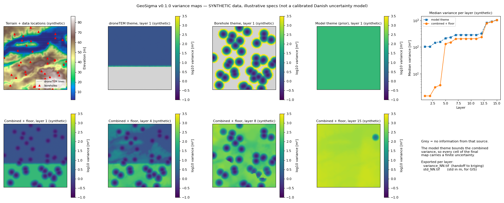

# GeoSigma

GeoSigma is an open-source Python library for geostatistical uncertainty modelling of 3D subsurface layer boundaries. Each layer boundary is treated as a spatially variable Gaussian field: GeoSigma quantifies the uncertainty of every boundary at every grid location and, once the simulation half is complete, will generate multiple equally probable hydrostratigraphic realizations from a deterministic input model.

The library is designed to be model-agnostic: the same workflow applies to any hydrostratigraphic model, independent of region or data source.

## Quick start

```bash
pip install -e .                       # from the repository root; see Installation
python examples/demo_variance_map.py   # builds per-layer variance maps end to end
```

**In Spyder:** start Spyder from the `geosigma` environment, open the example file and press **F5** (don't type the file name in the console). Under *Run → Configuration per file*, choose **Run in dedicated console**.

## Release scope: v0.1.0 and v1.0.0

GeoSigma is being built in two halves. **v0.1.0 contains only the first half, the variance-map tool.**

| | **v0.1.0 (this release)** | **v1.0.0 (planned)** |
|---|---|---|
| **What you get** | Per-layer **variance maps** of every layer boundary, built from your information sources (geophysics, boreholes, …) | Geostatistical **realizations** of the full layer model, conditioned using those variance maps |
| **Included** | Theme engine (`geosigma.themes`): built-in and YAML-defined themes, the ThemeData input format, parallel-precision combine, minimum-variance floor, GeoTIFF export · grid I/O (GeoTIFF, ESRI ASCII, Surfer 7) · `RegionConfig` · the translated geostatistical primitives (`precal_cov`, `least_squares_inversion`, `get_reals_cholesky`, INPOX, …) | Preprocessing (range/sill estimation, clustering) · the local kriging driver · realization generation on a whole model · layer assembly (zero-thickness ties, stratigraphic order) and export |
| **Demos** | [`examples/`](examples/): run end to end | [`examples/preview/`](examples/preview/): previews of the simulation workflow; they run, but the APIs may change before v1.0.0 |

The variance maps are a self-contained product. The kriging stage will take a per-layer variance-grid stack as input, whether it comes from GeoSigma's theme tool or from your own uncertainty method.

### Validation status (v0.1.0)

The built-in themes were run on the same input data as the original MATLAB implementation of the national hydrostratigraphic model of Denmark and compared cell by cell with the MATLAB reference grids: on spatial windows of the Jutland region, and for PACES and REFSEIS on the whole Funen and Zealand region grids. The comparison harness uses the full national datasets and is not part of this repository. Some reference grids in that MATLAB run were cached from older runs on older input data; where that limits a comparison, the table says so.

| Theme | Information source | Status |
|---|---|---|
| fewTEM | Ground-based TEM, few-layer models | ✅ Bit-exact (max \|Δ\| 7e-12; 2 of 294,654 cells differ at the window edge from complexity-map padding) |
| manyTEM | Ground-based TEM, many-layer models | ✅ Bit-exact (max \|Δ\| 1.8e-12) |
| SkyTEM | Airborne TEM | ✅ Bit-exact (max \|Δ\| 1.5e-11) |
| PACEP | Pulled-array continuous electrical profiling | ✅ Bit-exact (max \|Δ\| 1.4e-14) |
| MEP | Multi-electrode profiling | ✅ Bit-exact (max \|Δ\| 8.5e-14, including Wenner-array data) |
| REFSEIS | Reflection seismics | ✅ Bit-exact on Zealand (whole region grid, max \|Δ\| 2.9e-11) with two MATLAB errors emulated in the harness: the thickness mask lands on the wrong cells, and unknown complexity is blanked in the first layer only (see [`docs/deviations_from_matlab.md`](docs/deviations_from_matlab.md)). On Jutland the same two errors account for the deeper layers (bit-exact on the whole grid in a tested layer). The shallower seismic layers (engine layers 12–26) differ from the reference: under investigation. |
| GAMMALOG | Gamma borehole logs | ✅ Bit-exact (max \|Δ\| 9e-16) |
| RESLOG | Resistivity borehole logs | ✅ Bit-exact (max \|Δ\| 2e-13) |
| Wells | Lithological borehole descriptions | ◐ **Partly validated.** Snapped wells: coverage matches, and values match exactly where the reference used the same complexity map. The Jupiter-borehole contribution is missing from the reference, so it is untested. The validation covers the code: the national maps from 2022/23 were computed with swapped Jupiter quality ratings from MST's data-preparation script (good and bad inverted), an error in the input data, not in MATLAB or GeoSigma. |
| tTEM | Towed TEM | ◐ **Partly validated.** No-data handling matches inside the combined map. No tTEM reference grid exists and the comparison window held no tTEM data, so informative values are untested. |
| PACES | Pulled-array continuous electrical sounding | ✅ Bit-exact on Funen (whole region grid, max \|Δ\| 8.9e-16) with the certainty function of that run, `ILM_sep2023`, and on Funen-MST with both `RBM_oct2023` and `ILM_oct2023` (max \|Δ\| 1.8e-15). `paces_spec` uses `FRAFA_apr2023`, the function of the Jutland run; there, no PACES reference grid exists. |
| **Combine + floor** | All themes → final variance map | ✅ Matches to machine precision (median relative difference 0) wherever the reference is current. The remaining 2.3 % of cells come from the cached PACES and REFSEIS references. |

"Bit-exact" means agreement to floating-point round-off (max absolute difference ≤ 1e-10 m²). Closing the open rows needs a fresh MATLAB reference run on current data. The geostatistical primitives that v1.0.0 builds on are covered by unit tests.

### The simulation (v1.0.0) and MATLAB

The simulation implements the method published in Madsen et al. (2026), *Mathematical Geosciences* (see [References](#references)), with deliberate improvements. Its output can therefore **not be compared with MATLAB bit for bit**, unlike the variance-map tool above. One improvement departs from the published method itself: realizations from the cluster areas are merged with `variance_correction=True` by default, so the merged realizations carry the variance the posterior standard deviation reports; `variance_correction=False` gives the published method's behaviour with the same algorithm as the MATLAB code (the realizations still differ from MATLAB's, because MATLAB and Python use different random-number generators). Documentation of the improvement follows. Every deviation, and how to get the original behaviour where that is possible, is listed in [`docs/deviations_from_matlab.md`](docs/deviations_from_matlab.md).

## Capabilities

- **v0.1.0:** Construct per-layer variance maps for layer boundaries from multiple information sources (TEM, PACES, gamma and resistivity logs, seismic reflectors, boreholes, or your own source defined in a YAML spec)
- **v0.1.0:** Export variance maps as GeoTIFF rasters for use in downstream modelling workflows
- **v1.0.0:** Estimate the local variogram range at sampled points with a pretrained neural-network estimator (`geosigma.preprocess.rangesill`; sill is a closed-form statistic, not learned) and group points into kriging zones (`geosigma.preprocess.clusters`)
- **v1.0.0:** Condition each layer boundary by local kriging (`geosigma.kriging`), then draw geostatistical realizations directly from the posterior covariance by Cholesky decomposition (`get_reals_cholesky`), not by sequential simulation, and merge the realizations from the cluster areas into one coherent surface
- **Experimental:** Integrate with PEST for parameter perturbation and ensemble-based uncertainty propagation (to be reviewed together with the simulation for v1.0.0)

## Installation

GeoSigma is pure Python and its dependencies all ship binary wheels on PyPI, so
a plain `pip` install needs no compiler and no system GDAL. **`pip install -e .`
is required:** the demos import `geosigma`, `utils` and `plotting` as installed
packages, so without it they only work when started from the repository root.

**With pip (any virtual environment):**

```bash
git clone https://github.com/rbm-geus/GeoSigma.git
cd GeoSigma
python -m venv .venv
source .venv/bin/activate      # Windows: .venv\Scripts\activate
pip install -e .
```

A cold install from PyPI takes roughly two minutes, mostly spent downloading
`numpy`, `pandas`, `matplotlib` and `rasterio`.

**With conda** (use this if you want the GDAL/PROJ stack managed by conda, e.g.
to share it with other geospatial tools):

```bash
git clone https://github.com/rbm-geus/GeoSigma.git
cd GeoSigma
conda env create -f environment.yml
conda activate geosigma
pip install -e .
```

`environment.yml` is the authoritative conda dependency declaration;
`pyproject.toml` declares the pip dependencies.

The range/sill neural-network estimator (`geosigma.preprocess.rangesill`) needs
the optional `torch` dependency, kept out of the core install because it's large
and platform-specific: `pip install -e ".[nn]"`.

> **Known issue, Windows + conda:** a pip-installed `torch` fails to load in a
> conda environment on Windows (`WinError 127`), because conda's MKL-linked
> NumPy and pip's torch ship conflicting OpenMP runtimes. Use a plain pip
> virtual environment for the `nn` extra until `environment.yml` installs
> PyTorch from conda-forge.

### Check the install

```bash
python -c "import geosigma, importlib.metadata as m; print('geosigma', m.version('geosigma'))"
python -c "from geosigma.themes import build_theme, ThemeSpec; print('themes OK')"
```

Running `pytest` from the repository root runs the full test suite (about 360
tests, under a minute); it needs the `dev` extra: `pip install -e ".[dev]"`.
The range/sill tests are skipped unless the `nn` extra is installed.

## Getting Started

The `examples/` directory contains standalone v0.1.0 scripts. They locate their
data relative to the script file, so they run from any working directory.

- `demo_variance_map.py`: **start here.** Runs the variance-map tool end to end: two synthetic information sources on the sample model, plus the model theme (the background variance) → per-layer themes → combined, floored variance map → GeoTIFFs in `examples/output/demo_variance_map/`. Each layer is written twice: `variance_NN.tif` is the handoff file for kriging, and `std_NN.tif` holds the standard deviation in metres for viewing in QGIS/ArcGIS. The data points are synthetic and the theme specs are illustrative, not a calibrated uncertainty model.

  **Expected output**

  

- `demo_region_config.py`: describe a model's layers and surface files with a `RegionConfig`.
- `demo_load_hydrostrat_model_geotiff.py`, `demo_load_jutland_hydrostrat_model.py`, `demo_load_hydrostrat_layer_geotiff.py`: load and plot the sample Jutland model (GeoTIFF).
- `demo_load_funen_hydrostrat_model.py`: load a model supplied as ESRI ASCII grids (Funen).
- `theme_specs/`: example YAML theme specs. `dronetem.spec.yaml` describes a hypothetical, illustrative source.

[`examples/preview/`](examples/preview/) holds **v1.0.0 previews** of the simulation workflow: INPOX point extraction, range/sill estimation, clustering, local kriging, realizations and layer stacking. They run, but the simulation is still being reviewed and its APIs may change before v1.0.0; see the README there.

Example data (sample Jutland and Funen hydrostratigraphic models) is included in `examples/data/`.

> **The demos are figure-driven.** Each script ends in a blocking
> `plt.show()` window, so look for the plot window and close it to let the
> script exit. To run one headless (in CI, or over a connection with no
> display), force the non-interactive backend first:
>
> ```bash
> MPLBACKEND=Agg python examples/demo_variance_map.py
> ```

## Documentation

- [`docs/theme_format.md`](docs/theme_format.md) — the ThemeData three-file format: the portable, model-agnostic bundle (points CSV, manifest, optional complexity grid) in which a theme's input data are supplied and archived.
- [`docs/deviations_from_matlab.md`](docs/deviations_from_matlab.md) — where the simulation (v1.0.0) deliberately departs from the MATLAB implementation, and how to reproduce MATLAB's behaviour where that is possible.
- [`docs/bring_your_own_data.md`](docs/bring_your_own_data.md) — the scientific-choices guide: the thirteen modelling decisions behind a theme and its combination (including the model's background variance), how to reason about each for your own region and data, and a complete worked example.

## Background

GeoSigma is developed at the Geological Survey of Denmark and Greenland (GEUS) as a clean Python reimplementation of a MATLAB-based workflow originally developed for generating stochastic realizations of the national-scale hydrostratigraphic model of Denmark. The original MATLAB source is included in `matlab_reference/` for reference and is not intended to be run directly.

Some core functions are adapted from the open-source [mGstat](https://github.com/AUProbGeo/mGstat) MATLAB library (T.M. Hansen), which is MIT-licensed; those files carry individual credit notices.

## References

- Madsen, R. B., Falk, F. A., Møller, I., Troldborg, L., & Høyer, A.-S. (2026). Probabilistic Modeling and Uncertainty Simulations of National-Scale Hydrostratigraphic Models: An Example from Denmark. *Mathematical Geosciences*. https://doi.org/10.1007/s11004-025-10263-9
- Falk, F. A., & Madsen, R. B. (2023). Machine learning-based estimation and clustering of statistics within stratigraphic models as exemplified in Denmark. *GEUS Bulletin*, 53. https://doi.org/10.34194/geusb.v53.8353 (reference for the range/sill network; the sill is the sample variance, and "trained without noise" means each training realization is free of components from other realizations, see `docs/deviations_from_matlab.md`)
- Madsen, R. B., Falk, F. A., Møller, I., & Høyer, A.-S. (2024). Introducing INPOX: a method for informed point extraction from geological 2D surfaces exemplified on the Danish national hydrostratigraphic model. *GEUS Bulletin*, 57. https://doi.org/10.34194/geusb.v57.8364

## License

ISC License — see [`LICENSE`](LICENSE).

Third-party components, and the mGstat attribution required by its MIT license, are documented in [`THIRD_PARTY_NOTICES.md`](THIRD_PARTY_NOTICES.md).
